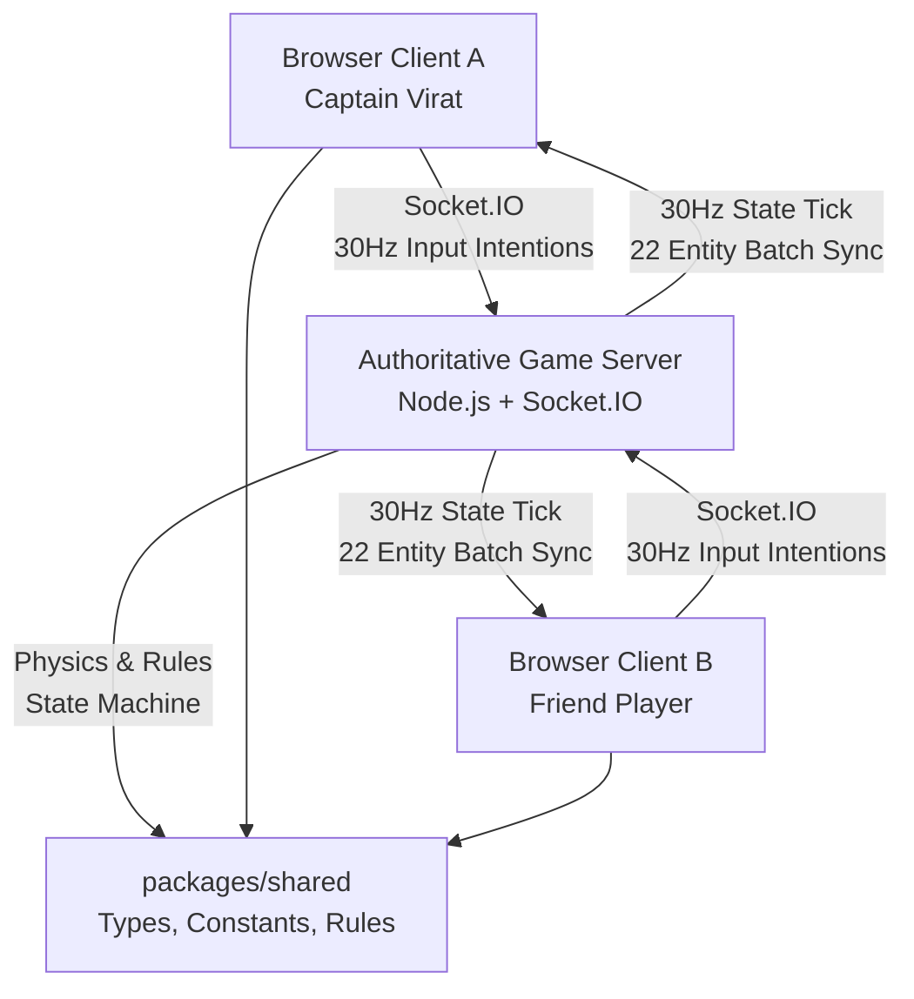

# Cricket 2026 🏏

A realistic, high-fidelity 3D multiplayer cricket browser game built with modern web technologies and authoritative client-server architecture.

---

## Architecture Overview



Cricket 2026 is organized as an npm workspace monorepo:

- **`packages/shared`**: Single source of truth containing official ICC pitch/ground dimensions, physics constants, match state machine, typed Socket.IO event contracts, and input validators.
- **`packages/server`**: Authoritative Node.js + Express + Socket.IO server (`port 4000`) executing room management, player authorization, rate limiting, and 30Hz game loops.
- **`packages/client`**: React 19 + Vite + Three.js / React Three Fiber frontend (`port 5173`) featuring physically accurate stadium rendering, dynamic lighting, remote entity interpolation, and a full multiplayer lobby.

---

## Phase 2 Implementation: Real-Time Multiplayer Room Management

### 1. Rooms & Friend Management
- **Private Room Creation**: Hosts generate private rooms with unique 6-character alphanumeric room codes (e.g., `CRK9A2`, `VVCLXA`).
- **Join by Code**: Friends join using the 6-character room code with instant feedback, auto-balancing between Team A and Team B.
- **Connected Friends Roster**: Real-time participant list displaying display names, host crown badges, connection latencies (ping ms), ready status, and disconnect warnings.
- **11v11 Playing XI Roster**: Full 22 on-field positions (11 for Team A - Royal Strikers, 11 for Team B - Titans XI) covering all standard cricket roles (Opener, Middle Order, All-Rounder, Wicketkeeper, Fast Bowler, Spin Bowler, Deep Fielder, Slip, etc.).
- **Slot Claiming & Conflict Prevention**: Players can click any unoccupied slot to claim it. The server prevents stealing another human's claimed slot and automatically re-assigns the vacated position back to AI.
- **Vacant Position AI Backfill**: Any slot not claimed by a human player is fielded by an AI cricketer marked with `🤖 AI`.

### 2. Documented Minimum Player Requirement
- **Rule**: A full cricket match features 22 positions, but the game **does not require 22 human players**.
- **Default Minimum**: `MIN_PLAYERS_PER_TEAM = 1` (total 2 human players for a 1v1 match, with the remaining 20 positions controlled by AI).
- **Host Configurable**: The room owner can configure `minPlayersPerTeam` anywhere from 1 to 11 in the Match Configuration drawer.
- **Enforcement**: The match start button is disabled until both Team A and Team B satisfy the minimum player requirement and all human players have set their status to **Ready**.

### 3. Authoritative Synchronization & Security
- **Movement Intentions**: Clients submit `player:move_input` events containing target position, rotation, velocity, animation state (`IDLE`, `WALK`, `RUN`, `SPRINT`, `SLIDE`, `DIVE`), sequence number, and timestamp.
- **Authorization & Anti-Spoofing**: The server validates that `socket.assignedPlayerId === input.playerId`. If any client attempts to control another player or an unassigned AI position, the server rejects the packet with `'UNAUTHORIZED_CONTROL'`.
- **Duplicate & Stale Input Filtering**: Sequence numbers must be strictly monotonic. Out-of-order or duplicate sequence numbers are dropped immediately.
- **Token-Bucket Rate Limiting**: The server enforces a maximum transmission rate of **35Hz** and a minimum packet interval of **20ms** per socket to protect against packet flooding.
- **Physical Boundary & Elevation Clamping**: Movement is clamped within the official ICC oval boundary (radius 65m + 3m buffer) and vertical elevation bounds (0m to 4m).
- **Remote Entity Interpolation**: The client interpolates remote players smoothly using Three.js `Vector3.lerp` and rotational lerp in the 60fps render loop to eliminate jitter.

### 4. Connection Resilience & Cleanup
- **Reconnection Grace Period**: If a player loses connection, the server preserves their claimed slot and team assignment for a **30-second grace window**. A persistent `reconnectToken` stored in `localStorage` allows instant reconnection.
- **Host Migration**: If the room host leaves or disconnects permanently, room ownership is automatically transferred to the next active player.
- **Room Destruction**: When all human participants leave, the GameSession loop is stopped and the room is deleted from memory.

---

## Phase 3 Implementation: Complete Pre-Match Experience

### 1. Match Configuration (5 Overs & 11v11 Lineup Customization)
- **5 Overs Default**: Default match length is strictly set to **5 overs per innings** across rules constants, room settings, and server sessions.
- **Playing XI Roster Customization**:
  - Full Lineup Customizer Modal (`LineupCustomizerModal`) allows teams to assign their **Captain (C)** and **Wicketkeeper (WK)**.
  - Reorder batting positions 1 through 11 using intuitive move up/down controls.
  - Assign specific cricketer roles (`BATSMAN`, `BOWLER`, `ALL_ROUNDER`, `WICKET_KEEPER`).
  - Choose team jersey themes (`GOLD_STRIPE`, `STRIPES_BLUE`, `ROYAL_EMERALD`, `CRIMSON_FLAME`).
  - Strict server-authoritative validation prevents duplicate batting orders, unknown players, or invalid roles.
- **Visual Presentation**: Shows team names, jersey colors, captain badges, wicketkeeper gloves, and clearly distinguishes assigned human players from AI-filled positions.

### 2. Server-Authoritative Toss Experience
- **Interactive Coin Toss**:
  - Heads-up faceoff modal displaying both captains with their respective national / club jerseys.
  - 3D CSS coin-flip animation with realistic rotational spin (`TOSS_FLIP_ANIMATION_MS = 2500ms`).
- **Authoritative Resolution**:
  - Away team (Team B) captain is prompted to call **HEADS** or **TAILS**.
  - Server securely resolves the flip outcome using cryptographic random generation and determines the winner.
  - Unauthorized participants attempting to call or decide the toss are rejected.
- **Bat / Bowl Innings Decision**:
  - The toss-winning captain chooses to **BAT** or **BOWL**.
  - Server authoritatively synchronizes `battingTeamId`, `bowlingTeamId`, `currentStrikerId`, `currentNonStrikerId`, and `currentBowlerId` to all connected clients.
  - Automatically repositions 3D outfielders and opening batsmen onto their respective pitch creases.

### 3. Umpire Adjudication System (AI vs Manual Human Umpire)
- **Pre-Match Selection**: Room owner can select between **AI Umpire** (fully automated adjudication) or **Manual Human Umpire** (assigns an authorized participant).
- **Supported Decisions**: Official ICC cricket signals:
  `OUT`, `NOT_OUT`, `WIDE`, `NO_BALL`, `FOUR`, `SIX`, `DEAD_BALL`, `BYE`, `LEG_BYE`, `SHORT_RUN`.
- **Arbitrary Score Edit Protection**:
  - Enforced in both shared validators and server game sessions: umpires cannot inject arbitrary runs, wickets, or raw score overrides.
  - Any payload attempting to alter score tallies directly is strictly rejected.
- **10-Second Response Countdown**:
  - Manual umpire receives real-time adjudication prompts with a 10-second countdown bar.
  - If no decision is submitted within 10 seconds, safe fallback to AI umpire triggers automatically without delaying play.
- **Disconnect Resilience**:
  - If a manual umpire disconnects during the match, the server falls back seamlessly to AI adjudication.
  - When the manual umpire reconnects within the 30-second grace window, manual adjudication permissions are automatically restored.

### 4. Canonical Match State Machine
- **Lifecycle Phases**:
  `LOBBY` ➔ `TEAM_SELECTION` ➔ `TOSS` ➔ `INNINGS_SETUP` ➔ `ACTIVE_MATCH` ➔ `INNINGS_BREAK` ➔ `SECOND_INNINGS` ➔ `COMPLETED_MATCH`.
- **Match Setup Lockdown**: Any attempts to alter room settings, claim slots, or modify lineups once `status !== 'LOBBY'` are blocked.
- **State Preservation**: All match configurations, lineups, toss results, and phase progression are preserved through client reconnects.

---

## Phase 4 Implementation: Core Cricket Gameplay Engine

### 1. Authoritative 60Hz Physics Engine (`CricketPhysicsEngine`)
- **Numerical Flight Integration**: Authoritative Euler-Cromer flight simulation at 60Hz ($\Delta t = 1/60s \approx 16.6ms$) accounting for:
  - Downward gravity ($g = 9.81 m/s^2$)
  - Aerodynamic quadratic drag ($F_d = \frac{1}{2} \rho C_d A v^2$ with $\rho = 1.225 kg/m^3$, $C_d = 0.31$, ball mass $0.16 kg$, radius $0.036 m$)
  - Magnus effect for conventional swing, reverse swing, and spin deviation
- **Pitch Surface Interaction & Restitution**:
  - Restitution coefficients modeled by turf condition: Hard Turf ($e_y = 0.65, \mu_{xz} = 0.78$), Dusty Spinner ($e_y = 0.55, \mu_{xz} = 0.68$), Green Seamer ($e_y = 0.62, \mu_{xz} = 0.72$)
  - Spin deviation and drift transferred to horizontal velocity on pitch impact
- **Boundary & Ground Roll**:
  - Ground rolling deceleration ($a = -3.6 m/s^2$)
  - Boundary distance check ($R \ge 65.0m$): grounded balls award **4 runs**, aerial balls clearing the boundary full award **6 runs**

### 2. Server-Authoritative Bowling
- **Delivery Parameters**: Bowlers specify line (Outside Off, Off, Middle, Leg), length (Yorker, Full, Good Length, Short / Bouncer), release speed (85 to 155 km/h), effort percentage, and seam angle.
- **Supported Variations**:
  - *Swing*: `OUTSWING`, `INSWING`, `REVERSE_SWING`, `NONE`
  - *Spin*: `OFF_BREAK`, `LEG_BREAK`, `TOP_SPINNER`, `GOOGLY`, `ARM_BALL`, `FLIPPER`, `NONE`
- **Validation**: Strict boundary and speed limits enforced authoritatively on the server. Illegal delivery intentions are rejected.

### 3. Batting Collision & Timing Model
- **Geometric Collision Resolution**: Batting interaction resolved via contact window and timing offset ($\Delta t$ in ms):
  - **Sweet Spot** ($|\Delta t| \le 22ms$): Clean contact, maximum exit velocity, high probability of boundary 4 or 6.
  - **Good Timing** ($22ms < |\Delta t| \le 55ms$): Solid stroke into gaps for 1 or 2 runs.
  - **Mistimed Contact** ($55ms < |\Delta t| \le 88ms$): Spliced aerial balls with catching risks at mid-off/cover.
  - **Thick Edge** ($88ms < |\Delta t| \le 120ms$): Deflected edges carrying to slip or wicketkeeper.
  - **Complete Miss** ($|\Delta t| > 120ms$): Play and miss; clean bowled if delivery is on stump line.
- **Shot Variety**: Defensive blocks, straight drives, cover drives, on drives, pull shots, cut shots, and lofted aerial strokes.

### 4. Scoring, Extras & Legal Deliveries (MCC Rule Compliance)
- **Legal Delivery Counting**: Exactly 6 legal deliveries per over.
- **Wides**:
  - Off-side wide ($x > +0.88m$), leg-side wide ($x < -0.32m$), or bouncer ($y > 2.2m$)
  - Awards +1 run to team score and extras, charged against bowler's `runsConceded`
  - Does **NOT** advance balls in over and is **NOT** counted as a ball faced for the batter
- **No-Balls**:
  - Crease overstep ($z > -8.84m$)
  - Awards +1 run to extras, charged to bowler, does **NOT** advance legal balls in over
  - Batter cannot be dismissed bowled, caught, or LBW
- **Byes & Leg-Byes**:
  - Credited to team total and extras, counts as legal delivery
  - **NOT** charged against the bowler's runs conceded
- **Strike Rotation & Running Between Wickets**:
  - Strike rotates automatically on odd runs (1, 3)
  - Strike rotates automatically at the end of each completed 6-ball over
  - Active batters can call and run quick singles between wickets

### 5. Dismissals & Lineup Progression
- **Supported Wickets**: `BOWLED` (stump collision box), `CAUGHT` (aerial hang time & proximity), `LBW` (Hawk-Eye pad line and middle/off stump projection), `RUN_OUT`, and `STUMPED`.
- **Wicket Fall**: Dismissed batter marked `isOut = true`, fall of wicket recorded with score and overs, partnership reset to 0 runs and 0 balls.
- **Next Batter Entry**: Next batter in the team playing XI immediately takes the crease. All-out triggered at 10 wickets.

### 6. Scorecard & Match Progression
- **Comprehensive Scorecards**:
  - Batter: runs, balls faced, 4s, 6s, strike rate, dismissal commentary, on-strike indicator
  - Bowler: overs (e.g. `1.4`), legal balls, maidens, runs conceded, wickets, economy, dot balls, wides, no-balls
  - Partnership: current runs and balls
  - Extras: breakdown of wides, no-balls, byes, and leg-byes
- **Maiden Overs**: Bowlers conceding 0 runs across 6 legal balls in an over are credited with a maiden over.
- **Bowler Rotation**: After 6 legal deliveries, bowlers rotate (maximum 2 overs per bowler in a 5-over match).
- **Target Chase & Innings Transition**:
  - After 5 completed overs or 10 wickets in Innings 1, target is set to `runs + 1` and teams swap.
  - Innings 2 terminates immediately upon reaching the target (win by wickets) or after 5 overs / 10 wickets (win by runs or tie).

---

## Getting Started

### Prerequisites
- Node.js >= 20.17.0 (or Node.js 22 LTS)
- npm >= 10.0.0

### Installation
```bash
# Clone the repository and install all dependencies
npm install
```

### Running Tests
Run the comprehensive unit and integration test suite across all packages:
```bash
npm test
```
This executes **40 automated tests** across three authoritative test suites:
1. `src/__tests__/multiplayerRoomSync.test.ts` (12 tests):
   - Room creation with unique 6-character code
   - Room code validation & invalid code rejection
   - Multi-player joining & team balancing
   - 11v11 slot claiming & conflict prevention
   - Documented minimum player requirement enforcement
   - Authorization & unauthorized player control prevention
   - Stale input & sequence number tracking
   - Rate limiting protection (35Hz)
   - Movement boundary & speed clamp validation
   - Leave room, host migration & empty room cleanup
   - Disconnect grace period & reconnection with token
   - Room isolation
2. `src/__tests__/preMatchAndToss.test.ts` (10 tests + acceptance):
   - Exactly 5 overs per innings default & 11 positions per team (human + AI backfill)
   - Playing XI lineup customization (Captain, Wicketkeeper, 1-11 batting order, roles, jersey)
   - Lineup payload validation & duplicate rejection
   - Server-authoritative toss lifecycle (away caller, random coin resolution, winner bat/bowl selection, synchronized innings order)
   - Umpire modes (AI vs Manual human assignment & participant role switching)
   - Umpire signal validation & strict protection against arbitrary score injection
   - 10-second response timeout with safe automatic fallback to AI
   - Manual umpire disconnect resilience and state restoration on reconnect
   - State machine phase matrix verification & post-start modification lockout
   - End-to-end acceptance: two independent clients complete pre-match experience, toss, and reach synchronized match state.
3. `src/__tests__/gameplayEngine.test.ts` (7 tests + acceptance):
   - Numerical flight integration, aerodynamic drag, Magnus swing, turf bounce & speed bounds
   - Geometric bat-ball collision & timing model (sweet spot boundary 6, ground drive 4, miss/bowled)
   - Extras adjudication: wides, no-balls, legal ball counting, bowler runs, batter balls faced
   - Scorecard tracking: strike rotation on odd runs, boundaries, partnerships
   - Dismissals: bowled, caught, LBW, fall of wickets, partnership reset, and next batter entrance
   - Over progression, maiden over adjudication (0 runs across 6 balls), and bowler rotation
   - 5-over innings transition, target setting, 2nd innings chase, and victory adjudication by wickets/runs.
4. `src/__tests__/fieldingEngine.test.ts` (8 tests + acceptance):
   - Ground ball pickup reachability & possession tracking within 1.8m radius
   - Extended diving pickup & slide stops within 2.6m radius
   - Aerial catch adjudication ($0.35m \le y \le 2.4m$) derived from attributes & dismissal triggers
   - Throw execution, flight trajectory toward wickets, and possession handoff
   - Run-out adjudication when batters are outside safe crease
   - AI fielding continuous movement, physical speed bounds ($6.5 - 8.8 m/s$), and zero teleportation
   - Captain field position adjustments, pitch strip exclusion zones, and tactical preset application (`ATTACKING`, `DEFENSIVE`, `BALANCED`)
   - Strict multiplayer authorization and spectator isolation.

---

## Phase 5 Implementation: Human-Controlled Fielding & AI Support

### 1. Human Fielder Controls
- **Movement**:
  - `WASD` or Arrow Keys to move continuously across the 65m boundary oval.
  - `Shift` to sprint at physical velocity (up to $9.5 m/s$).
  - `Space` to jump or dive forward across the turf to intercept ground shots.
- **Ball Interaction & Throwing**:
  - `E` to pick up a ground ball within $1.8m$ or attempt a catch on an aerial ball in flight.
  - `Left Click` or `F` to return throw towards chosen stumps (`STRIKER_END` or `BOWLER_END`).
  - Aiming and throw power slider (0 to 100%) providing realistic flight speeds ($28 m/s \approx 100 km/h$).

### 2. Fielding Gameplay & Authoritative Physics
- **Ball Possession**: Synchronized across all clients via `game:ball_possession` and displayed visually as a 3D cricket ball in the fielder's hand.
- **Catch Adjudication**: Aerial balls ($0.35m \le y \le 2.4m$) intercepted before bouncing trigger statistical catch checks based on player `fieldingCatching` attributes (never guaranteed 100%, never 0%).
- **Run-Out Mechanics**: Throws traveling to wickets evaluate batter transit. If a run is called and the batter has not crossed their popping crease, the wicket is broken and `RUN_OUT` is awarded.
- **Captain Field Tactics**:
  - Bowling captain can adjust individual fielder coordinates between deliveries.
  - Pitch strip exclusion safety zone ($|x| < 1.6m, |z| \le 11m$) prevents fielders from obstructing the pitch.
  - One-click tactical presets:
    - **⚡ Attacking**: Slips, gully, and aggressive ring fielders.
    - **🛡️ Defensive**: Deep boundary sweepers and long-on/long-off coverage.
    - **⚖️ Balanced**: Standard 11-player outfield distribution.

### 3. AI Fielding Support
- **Full Vacant Position Coverage**: AI controls every cricketer not currently assigned to a human player.
- **Continuous Physics Stepping**: AI fielders move via frame-time numerical stepping (`computeFielderStep`) clamped to physical speed limits ($6.5 - 8.8 m/s$). **Zero teleportation or instant snapping**.
- **Human Priority**: AI interceptor evaluation yields ball collection to human players if a human fielder is in proximity ($\le 2.0m$).
- **Intelligent Throw Targets**: Evaluates batter crease transit and returns throws to the most vulnerable end.

### 4. Spectator Behavior & Multiplayer Isolation
- Unassigned participants watch matches cleanly in Spectator Mode with multi-perspective camera orbiting.
- Strict server authorization prevents clients from controlling cricketers assigned to other players.

---

## Phase 6 Implementation: Realistic 3D Cricket Presentation

### 1. Humanoid Models & Authentic Cricket Equipment
- **Anatomically Proportioned Humanoids**: Modular 1.82m athletic player models with articulated neck, head sculpt, tapered torso, deltoid shoulders, elbows, forearms, hips, knees, calves, ankles, and spiked footwear.
- **Protective Cricket Helmets**: Hard outer composite shell with ventilation ducts, team colors, peak, and realistic metallic safety faceguard grille (chin bar, brow bar, vertical wire struts).
- **Caps & Sunhats**: Peaked team cap with curved visor and team crest badge for fielders/bowlers; classic wide-brim white sunhat with black hatband for umpires.
- **English Willow Cricket Bat**: Modeled to official ICC profile specifications with curved bow face, thick power edges (~40mm scale), high rear spine ridge swell (sweet spot), duckbill toe, spiral chevron rubber cane handle grip, and branding decals.
- **Traditional Multi-Cane Pads**: Batting leg pads and wicketkeeper pads featuring molded top-hat knee-rolls with horizontal flutes, vertical cane bolster ribs with stitching, side wings, and rear calf/ankle straps.
- **Gloves & Spikes**: Segmented sausage-finger batting gloves with thumb block; large webbed wicketkeeper catching gloves; modern cricket boots with molded spiked soles and contrast laces.
- **Separate Visual Roles**: Distinct equipment sets and postures for **Batters**, **Bowlers**, **Wicketkeepers**, **Fielders**, and **Umpires**.
- **Asset Licensing**: Documented in [`ASSETS_LICENSE.md`](file:///d:/Cricket2026/ASSETS_LICENSE.md) — 100% original procedural geometry and audio synthesis with zero unauthorized third-party commercial assets.

### 2. Procedural Skeletal Animation Kinematics
- **Batting System**:
  - `BATTING_STANCE`: Balanced side-on stance, bent knees, tapping bat behind popping crease.
  - `BACKSWING`: Bat raised cocked back, elbows bent, weight loaded onto feet.
  - `SHOT_EXECUTION`: Dynamic downswing arc through the ball plane, torso rotating into the shot.
  - `DEFENSIVE_BLOCK`: Front knee bent forward, bat and pad pressed tight together under the eyes with soft hands.
  - `FOLLOW_THROUGH`: Elegant high-elbow follow-through with the bat pointing skywards.
- **Bowling Kinematics**:
  - `BOWLER_RUNUP`: Rhythmic running gait with pumping arms, accelerating towards crease.
  - `DELIVERY_STRIDE`: Jump and gather, non-bowling arm raised high pointing at the target.
  - `RELEASE`: Front foot plant, full 360-degree high overarm vertical delivery at 12 o'clock, ball releasing at apex.
  - `BOWLER_FOLLOW_THROUGH`: Natural cross-body follow-through stride decelerating off danger pitch area.
- **Running, Fielding & Diving**:
  - `RUN` & `SPRINT`: Dynamic cricket running strides holding bat in hand with forward athletic lean.
  - `DIVE`: Full horizontal turf slide/dive, body parallel to grass, arms outstretched.
  - `FIELDING_PICKUP`: Long-barrier knee down to scoop ball cleanly.
  - `CATCHING`: Reaching up with soft cupped hands cushioning ball into chest.
  - `THROWING`: Overarm throw with body weight transfer.
- **Umpire Signals & Celebrations**:
  - `OUT` (raised index finger), `FOUR` (arm sweep across chest), `SIX` (both arms raised high), `WIDE` (horizontal arms), `NO_BALL` (shoulder level arm).
  - Contextual bowler leap and fist pump celebrations.

### 3. Broadcast Presentation, Stadium Atmosphere & Audio Engine
- **6 Camera Perspectives with Smooth Damping**:
  - `1: Broadcast TV`: Elevated TV grandstand camera with dynamic ball tracking and smooth crane damping.
  - `2: Batting Stance`: Over-the-shoulder batter-follow camera looking down pitch towards bowler.
  - `3: Bowler Mark`: Perspective behind bowler at delivery mark looking down pitch towards striker's wickets.
  - `4: Field-Side`: Dugout / slip cordon ground perspective across the pitch.
  - `5: Free Orbit`: Free spectator orbit camera with elevation limits.
  - `6: Action Replay`: Cinematic slow-motion replay camera angle focusing on striker wicket zone.
- **Web Audio Procedural Sound Engine (`CricketAudioEngine`)**:
  - Authentic English willow crack (sweet spot, standard, snick edge, pad thud).
  - Wooden stump clatter and flying bail rattle.
  - Turf bounce thuds and player footstep/grass slide friction sounds.
  - Dynamic stadium crowd soundscape: ambient murmur, surging boundary roar on 4s and 6s, wicket roar & applause, gasp on dropped catches.
  - Master, crowd, and SFX volume sliders wired to `GameSettings`.
- **Dynamic 3D Jumbotrons**:
  - Giant North & South LED jumbotron screens displaying live batting/bowling team names, score, overs, required run rate, and ball release speed.

### 4. Graphics Settings & Scalable Performance
- **Low**: Shadows disabled, single directional light, crowd off, simplified geometry, optimized draw calls.
- **Medium**: 1024x1024 directional shadow maps, medium crowd density (3 tiers), standard shaders.
- **High / Ultra**: 2048x2048 directional shadow maps, 4 corner floodlight tower spotlights casting authentic multi-angle cross-shadows, full crowd (5 tiers), atmospheric ground fog.

### Type Checking & Production Build
```bash
# Type check all packages
npm run typecheck

# Build production bundles
npm run build
```

### Running Development Servers
To run the server and client simultaneously:

```bash
# Terminal 1: Start Authoritative Game Server (Port 4000)
npm run dev:server

# Terminal 2: Start Vite Client (Port 5173)
npm run dev:client
```

Open `http://localhost:5173/` in your browser.

---

## Multi-Session Browser Testing

To test real-time multiplayer room management with multiple players:

1. **Player 1 (Host)**:
   - Open `http://localhost:5173/` in standard browser window.
   - Enter name **"Captain Virat"** and click **"Create Private Room"**.
   - Note the generated 6-character Room Code (e.g., `CRK9A2`).
2. **Player 2 (Friend)**:
   - Open `http://localhost:5173/` in an **Incognito / Private** window or secondary browser.
   - Enter name **"Friend Steve"**, input the 6-character Room Code, and click **"Join Match"**.
3. **Verify Multiplayer Features**:
   - Both players appear in the **Connected Friends** roster with live ping.
   - Player 2 is assigned to Team B; Player 1 to Team A.
   - Click different slots in the 11v11 roster to switch positions.
   - Try claiming an already occupied slot to verify conflict rejection.
   - Both players toggle **Ready** to satisfy the documented minimum requirement (1 human per team) and enable match start.
   - Close Player 2's tab to observe the 30-second disconnect notice; reopen within 30 seconds to observe seamless reconnect.

---

## Phase 8: Stabilization & Production Deployment

### 1. Security & Protection Model
- **Strict Payload Validation**: All incoming Socket.IO events (room creation, slot claims, toss decisions, batting/bowling intents, field adjustments, and umpire signals) are validated against official schema constraints.
- **Server Authority**: Scores, wickets, overs, ball trajectories, and match results are strictly calculated by the authoritative server loop. Clients cannot manipulate scorecards or game physics.
- **Credential Privacy**: Session `reconnectToken`s are issued privately via socket callbacks and never exposed in public `room:state` broadcasts.
- **Multi-Level Rate Limiting**:
  - Socket event throttle: maximum 60 incoming events per second per socket.
  - Movement input throttle: 35Hz maximum update rate with minimum 20ms intervals and strictly monotonic sequence numbers.
- **Room Capacity**: Configurable maximum room capacity (`MAX_ROOMS=100`) preventing server memory exhaustion.
- **Abandoned Room Sweep**: Inactive rooms are swept after 30 minutes of inactivity (`ROOM_INACTIVITY_TTL_MS=1800000`). Abandoned rooms where all participants have disconnected past the 30-second grace window are automatically destroyed.

### 2. Operational Health Checks
The persistent backend exposes a production health check at `GET /health` returning real-time metrics:
```json
{
  "status": "ok",
  "game": "Cricket 2026 Server",
  "version": "1.0.0",
  "activeRooms": 3,
  "activeSockets": 6,
  "uptimeSeconds": 1420,
  "memory": {
    "rss": 54231040,
    "heapTotal": 29818880,
    "heapUsed": 18274120,
    "external": 2401824
  },
  "timestamp": "2026-10-24T18:14:00.000Z"
}
```

### 3. Production Deployment Guide

#### A. Static Frontend (Vercel)
1. Import the repository into Vercel.
2. Set **Root Directory** to `packages/client` (or leave root with the included [packages/client/vercel.json](file:///d:/Cricket2026/packages/client/vercel.json)).
3. Configure Environment Variables:
   - `VITE_SERVER_URL`: `https://<your-backend-service>.onrender.com`
4. Build Command: `npm run build`
5. Output Directory: `dist`

#### B. Persistent Backend (Render / Railway / Persistent Node.js)
The authoritative server requires a persistent Node.js environment with sticky WebSocket support.
- **1-Click Render Deploy**: Connect your repository to Render. It automatically reads [render.yaml](file:///d:/Cricket2026/render.yaml) to configure the web service with health checks on `/health`.
- **Environment Variables**:
  - `PORT`: `4000`
  - `NODE_ENV`: `production`
  - `CORS_ORIGIN`: `https://<your-frontend-app>.vercel.app` (or comma-separated list of origins)
  - `TICK_RATE_HZ`: `30`
  - `DEFAULT_OVERS`: `5`
  - `RECONNECT_GRACE_MS`: `30000`
  - `MAX_ROOMS`: `100`

#### C. Containerized Docker Deployment
A multi-stage [Dockerfile](file:///d:/Cricket2026/Dockerfile) is provided:
```bash
# Build production image
docker build -t cricket2026-server:latest .

# Run container
docker run -d -p 4000:4000 \
  -e NODE_ENV=production \
  -e CORS_ORIGIN=https://cricket2026.vercel.app \
  cricket2026-server:latest
```
